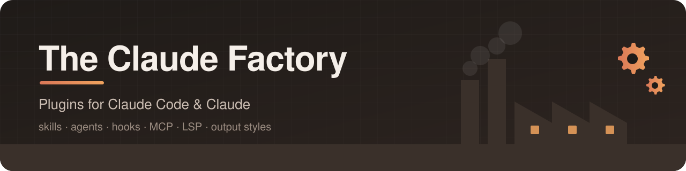

<div align="center">



<br>

**Production-grade plugins that automate, accelerate and harden the way you work with Claude.**

_Skills · Agents · Hooks · MCP servers · LSP servers · Output styles — packaged, versioned and ready to install._

<br>

<!-- plugin-count:start -->
[](#-catalog)
<!-- plugin-count:end -->
[](https://github.com/nerymurillohnd/the-claude-factory/actions/workflows/validate.yml)
[](https://biomejs.dev)
[](./LICENSE)
[](https://code.claude.com/docs/en/plugins/overview)

[**Quick start**](#-quick-start) •
[**Catalog**](#-catalog) •
[**Manage plugins**](#-manage-your-plugins) •
[**Compatibility**](#-where-plugins-work) •
[**Docs**](#-documentation) •
[**Support**](#-support)

</div>

---

## 🏭 What is The Claude Factory?

**The Claude Factory** is a public [plugin marketplace](https://code.claude.com/docs/en/plugins/overview) for **Claude Code** and the **Claude app**. Each plugin solves one real problem end to end — a workflow you repeat, a check you forget, a tool you wish Claude already knew — and installs with a single command.

|                   |                                                                                                 |
| :---------------- | :---------------------------------------------------------------------------------------------- |
| 🎯 **Focused**    | One plugin, one job, done well. No kitchen-sink bundles.                                        |
| 🧪 **Validated**  | Every release passes the official `claude plugin validate --strict` plus our own quality gates. |
| 🔖 **Versioned**  | Semantic versioning and a changelog for every plugin, so you always know what changed.          |
| 📖 **Documented** | Every plugin ships a README with requirements, usage, configuration and compatibility.          |
| 🔓 **Open**       | MIT-licensed. Read the source of anything before you install it.                                |

## ⚡ Quick start

> [!IMPORTANT]
> You need **[Claude Code](https://code.claude.com/docs/en/overview)** (terminal, desktop app, VS Code or JetBrains) or the **Claude app** (web, desktop or mobile). Keep Claude Code current — check with `claude --version`.

### 1️⃣ Add the marketplace (once)

<details open>
<summary><b>💻 Terminal</b></summary>

```bash
claude plugin marketplace add nerymurillohnd/the-claude-factory
```

</details>

<details>
<summary><b>💬 Inside a Claude Code session</b></summary>

```text
/plugin marketplace add nerymurillohnd/the-claude-factory
```

</details>

<details>
<summary><b>🖥️ Claude app (web and desktop)</b></summary>

1. Open **Customize** in the sidebar, then **Plugins**.
2. Select **Add** → **Add marketplace**.
3. Enter `nerymurillohnd/the-claude-factory` (or `https://github.com/nerymurillohnd/the-claude-factory`).

</details>

### 2️⃣ Install a plugin

Pick one from the [catalog](#-catalog), then:

| Where                  | Command / action                                                                                                                                                                                                |
| :--------------------- | :-------------------------------------------------------------------------------------------------------------------------------------------------------------------------------------------------------------- |
| 💻 Terminal            | `claude plugin install <plugin>@the-claude-factory`                                                                                                                                                             |
| 💬 Claude Code session | `/plugin install <plugin>@the-claude-factory` — or browse `/plugin` → **Discover**                                                                                                                              |
| 🖥️ Desktop app         | Any of three ways: **+** next to the prompt box → **Add plugins** (or **Plugins** → **Browse plugins**) · **Settings** → **Plugins** → **Discover** · **Customize** in the sidebar → **Plugins** → **Discover** |
| 🧩 VS Code             | Type `/plugins` → **Plugins** tab → **Install**                                                                                                                                                                 |
| 🖥️ Claude app          | **Customize** → **Plugins** → **Discover** → select the plugin → **Add**                                                                                                                                        |

> [!TIP]
> **Skip step 1.** Add the marketplace and install in one go:
>
> ```bash
> claude plugin install <plugin> --marketplace nerymurillohnd/the-claude-factory   # Claude Code v2.1.292+
> ```
>
> Inside a session: `/plugin install <plugin> --marketplace nerymurillohnd/the-claude-factory` (v2.1.275+).

### 3️⃣ Use it

Plugin skills are namespaced, so they never collide with yours: type `/<plugin>:` to see what a plugin adds. Run `/reload-plugins` if you installed into an open session.

## 📦 Catalog

<!-- catalog:start -->
<!-- biome-ignore format: generated by scripts/generators/catalog.mjs -->
| Category | Plugins |
| :-- | :--: |
| [🛠️ Development](#️-development) | 6 |
| [⚡ Productivity](#-productivity) | 2 |
| [🤖 Automation](#-automation) | 1 |
| [🧩 Mods](#-mods) | 3 |
| [🧪 Testing & Quality](#-testing--quality) | 3 |
| [🛡️ Security](#️-security) | 1 |
| [📚 Documentation & Writing](#-documentation--writing) | 2 |
| [🧠 Language Support](#-language-support) | 4 |

### 🛠️ Development

_Write, refactor, review and ship code faster._

<!-- biome-ignore format: generated by scripts/generators/catalog.mjs -->
| Plugin | What it does | Works in | Version | Includes |
| :-- | :-- | :-- | :--: | :-- |
| [**GitHub Operations**](./plugins/github-operations#readme)<br>`github-operations@the-claude-factory` | GitHub automation for Claude Code, with GitHub's MCP server or gh: takes pull requests from branch to merge (CI checks, code review comments, fixes), writes PR and issue templates, discussion forms, labels and Dependabot setup, repairs failing GitHub Actions CI, and runs repository audits and cleanup of branches, worktrees and stashes behind a verified backup. | 💻 Code only | `0.7.2` | 🎯 Skills · ⌨️ Commands · 🤖 Agents |
| [**macOS Grep Guard**](./plugins/macos-grep-guard#readme)<br>`macos-grep-guard@the-claude-factory` | Development guard for macOS: stops recursive grep from silently skipping gitignored and binary files, blocks BSD awk's ignored IGNORECASE, and adds the macOS form when a BSD or zsh command fails. | 💻 Code only | `0.1.4` | 🧩 Mods |
| [**Mods Engineering**](./plugins/mods-engineering#readme)<br>`mods-engineering@the-claude-factory` | Designs, builds, reviews, tests and debugs Claude Code mods: panes, bands, function hooks and the hooks module, checking every interface against the current mods API docs and the type declarations your own Claude Code build writes. Plugin development for the Claude Code interface. | 💻 Code · 🖥️ Claude app | `0.1.5` | 🎯 Skills |
| [**Plugin Engineering**](./plugins/plugin-engineering#readme)<br>`plugin-engineering@the-claude-factory` | Builds and maintains a public Claude Code plugin marketplace on GitHub from the official docs, distilled for plugins that third parties install: marketplaces, manifests, skills, agents, hooks, mods, MCP servers, settings, validation and releases, checked against the latest release notes. Includes the complete plugin CLI reference: every claude plugin and claude plugin marketplace subcommand, /plugin form and session flag, with exact flags, messages, JSON fields, exit codes and minimum versions. | 💻 Code · 🖥️ Claude app | `0.2.1` | 🎯 Skills |
| [**Svelte Development**](./plugins/svelte-development#readme)<br>`svelte-development@the-claude-factory` | Writes and reviews Svelte 5 and SvelteKit 3 frontend code by current practice (runes, snippets, Astro and Tailwind CSS projects) and runs the migration from Svelte 4 and SvelteKit 2, checking every change against the official Svelte docs MCP server and autofixer, the Svelte language server (LSP) and your project's own svelte-check. | 💻 Code · 🖥️ Claude app | `0.1.3` | 🎯 Skills · 🤖 Agents · 🔌 MCP · 🧠 LSP |
| [**Tailwind CSS Development**](./plugins/tailwind-development#readme)<br>`tailwind-development@the-claude-factory` | Designs, builds and refactors Tailwind CSS v4 (tailwindcss) frontend interfaces with a product designer's craft: UI design, design-system tokens, responsive design and dark mode, every utility class and variant grounded in its exact official documentation page and verified in your project. | 💻 Code · 🖥️ Claude app | `0.3.3` | 🎯 Skills · 🤖 Agents · 🪝 Hooks · 🔌 MCP |

### ⚡ Productivity

_Everyday workflows, planning and knowledge work._

<!-- biome-ignore format: generated by scripts/generators/catalog.mjs -->
| Plugin | What it does | Works in | Version | Includes |
| :-- | :-- | :-- | :--: | :-- |
| [**File Tree Pane**](./plugins/file-tree-pane#readme)<br>`file-tree-pane@the-claude-factory` | A live file explorer panel beside the chat: your project's file tree with git status, diffs and line counts, what Claude reads, writes and commits, search, file previews and your editor one key away. A Claude Code mod for productivity. | 💻 Code only | `0.1.6` | 🧩 Mods |
| [**Prompt Writer**](./plugins/prompt-writer#readme)<br>`prompt-writer@the-claude-factory` | Prompt engineering for Claude: turns a goal, idea or draft into one copy-ready prompt or system prompt tuned to the target Claude model and effort, clarifies intent, checks current official facts, helps with model migration and recommends the setup to run it with. | 💻 Code · 🖥️ Claude app | `0.2.5` | 🎯 Skills · 🪝 Hooks |

### 🤖 Automation

_Hooks, agents and pipelines that run work for you._

<!-- biome-ignore format: generated by scripts/generators/catalog.mjs -->
| Plugin | What it does | Works in | Version | Includes |
| :-- | :-- | :-- | :--: | :-- |
| [**Hook Engineering**](./plugins/hook-engineering#readme)<br>`hook-engineering@the-claude-factory` | Designs, writes, audits and debugs Claude Code hooks: hook events, matchers and configuration, exit codes and JSON decision control, prompt, agent and async hooks, MCP tool hooks, security and workspace trust, and how mods interact with hooks, checked against the current docs and changelog. Automation you can trust. | 💻 Code · 🖥️ Claude app | `0.2.5` | 🎯 Skills · 🤖 Agents |

### 🧩 Mods

_Panels, bands and status views that change Claude Code's own interface._

<!-- biome-ignore format: generated by scripts/generators/catalog.mjs -->
| Plugin | What it does | Works in | Version | Includes |
| :-- | :-- | :-- | :--: | :-- |
| [**Model Trace**](./plugins/model-trace#readme)<br>`model-trace@the-claude-factory` | Usage observability for Claude Code: shows, as Claude works, each skill, agent, MCP server, plugin, hook and web tool it uses in the session, how many times and at what time, with an export to Markdown or HTML. A Claude Code mod. | 💻 Code only | `0.1.4` | 🧩 Mods |
| [**Tool Ledger**](./plugins/tool-ledger#readme)<br>`tool-ledger@the-claude-factory` | Audit and observability panel for every tool call of the session: what ran, on what, whether Claude or a subagent made it, and whether it finished, failed or was denied by permissions or hooks. A Claude Code mod. | 💻 Code only | `0.1.5` | 🧩 Mods |
| [**Turn Meter**](./plugins/turn-meter#readme)<br>`turn-meter@the-claude-factory` | Shows how long each turn took (duration), how many tools it used in the main thread and in subagents, and the tokens it spent, in a status band above the prompt, with usage at a glance and a notification when a long turn ends. A Claude Code mod. | 💻 Code only | `0.1.5` | 🧩 Mods |

### 🧪 Testing & Quality

_Tests, audits, linting and quality gates._

<!-- biome-ignore format: generated by scripts/generators/catalog.mjs -->
| Plugin | What it does | Works in | Version | Includes |
| :-- | :-- | :-- | :--: | :-- |
| [**Plugin Evals**](./plugins/plugin-evals#readme)<br>`plugin-evals@the-claude-factory` | Makes Claude an expert in Claude Code plugin evals: designs eval suites and benchmarks that prove what a plugin or its skills add, writes cases, graders and mocks, runs and gates them in CI, and reads the results, always checked against the CLI and docs you have today. Testing and quality for plugins. | 💻 Code · 🖥️ Claude app | `0.1.6` | 🎯 Skills |
| [**Plugin Test Bench**](./plugins/plugin-test-bench#readme)<br>`plugin-test-bench@the-claude-factory` | Testing for Claude Code plugins before release: installs a copy the way your users receive it in a throwaway config, checks it loads, runs your plugin eval suite against that copy, and reviews your evals so they measure what the plugin adds. Quality you can prove. | 💻 Code only | `0.1.3` | 🎯 Skills |
| [**Skill Diagnostics**](./plugins/skill-diagnostics#readme)<br>`skill-diagnostics@the-claude-factory` | Audits Claude skills against the official best practices and gates them: five validation scripts, four independent reviewers, a cold executor and an adversarial verifier give one report with file-and-line evidence and one verdict, and a gate has Claude audit every skill it creates or changes before it finishes. | 💻 Code · 🖥️ Claude app | `0.3.0` | 🎯 Skills · 🤖 Agents · 🪝 Hooks · 🔁 Workflows |

### 🛡️ Security

_Guardrails, secret hygiene and security reviews._

<!-- biome-ignore format: generated by scripts/generators/catalog.mjs -->
| Plugin | What it does | Works in | Version | Includes |
| :-- | :-- | :-- | :--: | :-- |
| [**Block No Verify**](./plugins/block-no-verify#readme)<br>`block-no-verify@the-claude-factory` | Security guardrail for git: blocks Claude's commits and pushes that skip pre-commit hooks or signing (--no-verify, --no-gpg-sign, commit.gpgsign=false), so your hooks, linters and commit signing always run. | 💻 Code · 🖥️ Claude app | `0.1.5` | 🪝 Hooks |

### 📚 Documentation & Writing

_Docs, changelogs, records and written content._

<!-- biome-ignore format: generated by scripts/generators/catalog.mjs -->
| Plugin | What it does | Works in | Version | Includes |
| :-- | :-- | :-- | :--: | :-- |
| [**Instruction Engineering**](./plugins/instruction-engineering#readme)<br>`instruction-engineering@the-claude-factory` | Writes, edits, reviews, audits, debugs and refactors Claude Code instructions and memory files (CLAUDE.md, CLAUDE.local.md and .claude/rules at user and project scope) against the current loading rules, with a read-only checker and an independent reviewer agent. Documentation that Claude actually follows. | 💻 Code · 🖥️ Claude app | `0.1.3` | 🎯 Skills · 🤖 Agents |
| [**Project Maintainer**](./plugins/project-maintainer#readme)<br>`project-maintainer@the-claude-factory` | Keeps a project's memory and documentation in its .claude folder: architecture decisions recorded as ADRs, technical debt tracked in a ledger, and a session handoff that carries each session's state to the next one for continuity. | 💻 Code · 🖥️ Claude app | `0.2.6` | 🎯 Skills · 🪝 Hooks · 🧩 Mods |

### 🧠 Language Support

_LSP servers and code intelligence for specific languages._

<!-- biome-ignore format: generated by scripts/generators/catalog.mjs -->
| Plugin | What it does | Works in | Version | Includes |
| :-- | :-- | :-- | :--: | :-- |
| [**Bash LSP Intelligence**](./plugins/bash-lsp-intelligence#readme)<br>`bash-lsp-intelligence@the-claude-factory` | Bash and shell script code intelligence for Claude Code: connects bash-language-server (LSP), formats and lints every script Claude edits with shfmt and ShellCheck using your own configuration, reports the diagnostics, and teaches Claude to trace sourced files and same-named functions before a rename. | 💻 Code only | `0.2.8` | 🎯 Skills · 🪝 Hooks · 🧠 LSP |
| [**Python LSP Intelligence**](./plugins/python-lsp-intelligence#readme)<br>`python-lsp-intelligence@the-claude-factory` | Python code intelligence for Claude Code: connects the basedpyright language server (LSP), lints, formats and type-checks every Python file Claude edits with ruff and basedpyright using your own configuration, and teaches Claude to navigate by symbol, resolve aliases and imports, and fix diagnostics without suppressing them. | 💻 Code only | `0.3.3` | 🎯 Skills · 🪝 Hooks · 🧠 LSP |
| [**TypeScript 6 LSP Intelligence**](./plugins/typescript6-lsp-intelligence#readme)<br>`typescript6-lsp-intelligence@the-claude-factory` | TypeScript and JavaScript code intelligence for Claude Code: connects your TypeScript 6 language server (LSP), type-checks every file Claude edits with your own tsc under a strictest policy, and teaches Claude to find the program that owns a file and fix compiler diagnostics without unsafe assertions or suppressions. | 💻 Code only | `0.3.5` | 🎯 Skills · 🪝 Hooks · 🧠 LSP |
| [**TypeScript 7 LSP Intelligence**](./plugins/typescript7-lsp-intelligence#readme)<br>`typescript7-lsp-intelligence@the-claude-factory` | TypeScript and JavaScript code intelligence for Claude Code: connects the native TypeScript 7 language server (LSP), type-checks every file Claude edits with your own native TypeScript 7 compiler (tsc) under a strictest policy, and teaches Claude to find the program that owns a file and fix compiler diagnostics without unsafe assertions or suppressions. | 💻 Code only | `0.4.5` | 🎯 Skills · 🪝 Hooks · 🧠 LSP |

<sub>**Legend:** 🎯 Skills · ⌨️ Commands · 🤖 Agents · 🪝 Hooks · 🧩 Mods · 🔌 MCP · 🧠 LSP · 🎨 Output styles · 📡 Monitors · 🔁 Workflows · 🌈 Themes · ⚙️ Executables</sub>
<!-- catalog:end -->

## 🔧 Manage your plugins

| Task                            | 💻 Terminal                                           | 💬 In a session                                                                |
| :------------------------------ | :---------------------------------------------------- | :----------------------------------------------------------------------------- |
| **List installed plugins**      | `claude plugin list`                                  | `/plugin` → **Installed**                                                      |
| **See what a plugin adds**      | `claude plugin details <plugin>`                      | `/plugin` → **Installed** → select it                                          |
| **Update one plugin**           | `claude plugin update <plugin>@the-claude-factory`    | `/plugin` → **Installed** → **Update now**                                     |
| **Update everything from here** | —                                                     | `/plugin` → **Marketplaces** → **the-claude-factory** → **Update marketplace** |
| **Disable / enable**            | `claude plugin disable <plugin>@the-claude-factory`   | `/plugin` → **Installed** → **Space**                                          |
| **Uninstall**                   | `claude plugin uninstall <plugin>@the-claude-factory` | `/plugin` → **Installed** → **Uninstall**                                      |
| **Remove the marketplace**      | `claude plugin marketplace remove the-claude-factory` | `/plugin marketplace remove the-claude-factory`                                |

> [!TIP]
> 🔄 **Get updates automatically.** Third-party marketplaces start with auto-update **off**. Turn it on once: `/plugin` → **Marketplaces** → **the-claude-factory** → **Enable auto-update**.

In the **Claude app**, manage everything from **Customize** → **Plugins**: select **Check for updates** to pull new versions now, or open a plugin, open its menu and select **Remove**. Full details: [Managing plugins](./docs/managing-plugins.md).

> [!WARNING]
> Removing the marketplace **uninstalls every plugin** you installed from it.

## 🧭 Where plugins work

The same plugin installs in Claude Code and in the Claude app, but each loads a different subset of components. Every plugin README has its own **Compatibility** table.

| Component                             |                               Claude Code                                |                  Claude app                   |
| :------------------------------------ | :----------------------------------------------------------------------: | :-------------------------------------------: |
| 🎯 Skills                             |                                    ✅                                    |                      ✅                       |
| 🤖 Agents                             |                                    ✅                                    |             ⚠️ in Cowork sessions             |
| 🪝 Hooks                              |                                    ✅                                    |             ⚠️ in Cowork sessions             |
| 🧩 Mods                               | ✅ v2.1.287+, except Desktop on WSL; ⚠️ the band doesn't draw in VS Code |        ⚠️ listed for Claude Code only         |
| 🔌 Remote MCP servers                 |                                    ✅                                    | 🔗 connect on the plugin's **Connectors** tab |
| 🖥️ Local MCP servers                  |                                    ✅                                    |    ⚠️ in Cowork sessions on your computer     |
| 🧠 LSP · 🎨 Output styles · 🌈 Themes |                                    ✅                                    |                      ➖                       |
| 🔁 Workflows                          |               ✅ paid plans; on Pro, turn on in `/config`                |                      ➖                       |
| ⚙️ Executables in `bin/`              |                                    ✅                                    |                      ❌                       |

<sub>✅ loads · ⚠️ conditional · 🔗 manual step · ➖ ignored · ❌ the plugin can't be installed there. The Claude app (web, desktop and mobile) runs a conversation as a Cowork session when it can and as a chat conversation otherwise; agents, hooks and local MCP servers don't run in a chat conversation. Sources: [Use plugins in Claude](https://support.claude.com/en/articles/13837440-use-plugins-in-claude), [Plugin feature support across platforms](https://claude.com/docs/plugins/platform-support). More in [Compatibility](./docs/compatibility.md).</sub>

## 🛡️ Trust & safety

Plugins can run hooks, scripts and MCP servers on your machine. Before installing **any** plugin — from here or anywhere else:

- 🔍 Read its README and source: everything here is in [`plugins/`](./plugins).
- 🧾 Review what it adds in the install panel (**Will install**) or with `claude plugin details <plugin>`.
- 🔐 Report vulnerabilities privately — see our [Security policy](./SECURITY.md).

## 📚 Documentation

| Guide                                                                       | What you'll find                                                                       |
| :-------------------------------------------------------------------------- | :------------------------------------------------------------------------------------- |
| 📥 [Installation](./docs/installation.md)                                   | Adding the marketplace and installing plugins on every surface, scopes, private setups |
| 🔧 [Managing plugins](./docs/managing-plugins.md)                           | Updates, auto-update, disabling, uninstalling, removing the marketplace                |
| 🧭 [Compatibility](./docs/compatibility.md)                                 | What loads in Claude Code and the Claude app                                           |
| 🩺 [Troubleshooting](./docs/troubleshooting.md)                             | Fixes for the most common install and loading errors                                   |
| ❓ [FAQ](./docs/faq.md)                                                     | Quick answers about the marketplace, versions and support                              |
| 📖 [Official plugin docs](https://code.claude.com/docs/en/plugins/overview) | Anthropic's reference for plugins and marketplaces                                     |

## 💬 Support

| I want to…                  | Go here                                                                                                           |
| :-------------------------- | :---------------------------------------------------------------------------------------------------------------- |
| 🐞 Report a bug in a plugin | [Open a bug report](https://github.com/nerymurillohnd/the-claude-factory/issues/new?template=bug_report.yml)      |
| ✨ Suggest an improvement   | [Request a feature](https://github.com/nerymurillohnd/the-claude-factory/issues/new?template=feature_request.yml) |
| 💡 Propose a new plugin     | [Share a plugin idea](https://github.com/nerymurillohnd/the-claude-factory/issues/new?template=plugin_idea.yml)   |
| 📝 Fix the docs             | [Report a docs issue](https://github.com/nerymurillohnd/the-claude-factory/issues/new?template=docs_issue.yml)    |
| ❔ Ask a question           | [Ask here](https://github.com/nerymurillohnd/the-claude-factory/issues/new?template=question.yml)                 |
| 🔐 Report a vulnerability   | [Report privately](https://github.com/nerymurillohnd/the-claude-factory/security/advisories/new)                  |

> [!NOTE]
> This repository is maintained by its owners and **does not accept pull requests**. Issues are the way to contribute — every report is read and answered. See [Contributing](./CONTRIBUTING.md).

## 📝 Changelog

Marketplace-level changes (plugins added, updated or retired) are in [CHANGELOG.md](./CHANGELOG.md). Each plugin also keeps its own changelog in its folder.

## 📄 License

[MIT](./LICENSE) © Nery Murillo. Not affiliated with or endorsed by Anthropic. _Claude_ and _Claude Code_ are trademarks of Anthropic, PBC.

<div align="center">

<sub>Built with care for the Claude community · <a href="#top">Back to top ⬆️</a></sub>

</div>
