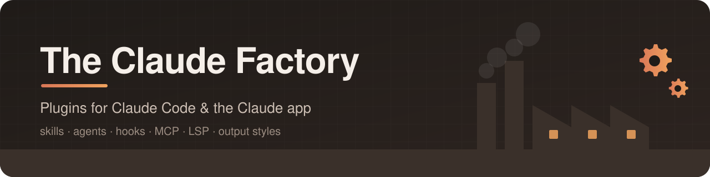

<div align="center">



<br>

**Production-grade plugins that automate, accelerate and harden the way you work with Claude.**

*Skills · Agents · Hooks · MCP servers · LSP servers · Output styles — packaged, versioned and ready to install.*

<br>

<!-- plugin-count:start -->
[](#-catalog)
<!-- plugin-count:end -->
[](https://github.com/nerymurillohnd/the-claude-factory/actions/workflows/validate.yml)
[](./LICENSE)
[](https://code.claude.com/docs/en/plugins/overview)

[**Quick start**](#-quick-start) •
[**Catalog**](#-catalog) •
[**Manage plugins**](#-manage-your-plugins) •
[**Compatibility**](#-where-plugins-work) •
[**Docs**](#-documentation) •
[**Support**](#-support)

</div>

---

## 🏭 What is The Claude Factory?

**The Claude Factory** is a public [plugin marketplace](https://code.claude.com/docs/en/plugins/overview) for **Claude Code** and the **Claude app**. Each plugin solves one real problem end to end — a workflow you repeat, a check you forget, a tool you wish Claude already knew — and installs with a single command.

| | |
| :-- | :-- |
| 🎯 **Focused** | One plugin, one job, done well. No kitchen-sink bundles. |
| 🧪 **Validated** | Every release passes the official `claude plugin validate --strict` plus our own quality gates. |
| 🔖 **Versioned** | Semantic versioning and a changelog for every plugin, so you always know what changed. |
| 📖 **Documented** | Every plugin ships a README with requirements, usage, configuration and compatibility. |
| 🔓 **Open** | MIT-licensed. Read the source of anything before you install it. |

## ⚡ Quick start

> [!IMPORTANT]
> You need **[Claude Code](https://code.claude.com/docs/en/overview)** (terminal, desktop app, VS Code or JetBrains) or the **Claude app** (web, desktop or mobile). Keep Claude Code current — check with `claude --version`.

### 1️⃣ Add the marketplace (once)

<details open>
<summary><b>💻 Terminal</b></summary>

```bash
claude plugin marketplace add nerymurillohnd/the-claude-factory
```

</details>

<details>
<summary><b>💬 Inside a Claude Code session</b></summary>

```text
/plugin marketplace add nerymurillohnd/the-claude-factory
```

</details>

<details>
<summary><b>🖥️ Claude app (web and desktop)</b></summary>

1. Open **Customize** in the sidebar, then **Plugins**.
2. Select **Add** → **Add marketplace**.
3. Enter `nerymurillohnd/the-claude-factory` (or `https://github.com/nerymurillohnd/the-claude-factory`).

</details>

### 2️⃣ Install a plugin

Pick one from the [catalog](#-catalog), then:

| Where | Command / action |
| :-- | :-- |
| 💻 Terminal | `claude plugin install <plugin>@the-claude-factory` |
| 💬 Claude Code session | `/plugin install <plugin>@the-claude-factory` — or browse `/plugin` → **Discover** |
| 🖥️ Desktop app, Code tab | **+** → **Plugins** → **Add plugin** |
| 🧩 VS Code | Type `/plugins` → **Plugins** tab → **Install** |
| 🖥️ Claude app | **Customize** → **Plugins** → **Discover** → select the plugin → **Add** |

> [!TIP]
> **Skip step 1.** Add the marketplace and install in one go:
>
> ```bash
> claude plugin install <plugin> --marketplace nerymurillohnd/the-claude-factory   # Claude Code v2.1.292+
> ```
>
> Inside a session: `/plugin install <plugin> --marketplace nerymurillohnd/the-claude-factory` (v2.1.275+).

### 3️⃣ Use it

Plugin skills are namespaced, so they never collide with yours: type `/<plugin>:` to see what a plugin adds. Run `/reload-plugins` if you installed into an open session.

## 📦 Catalog

<!-- catalog:start -->
| Category | Plugins |
| :-- | :--: |
| [⚡ Productivity](#-productivity) | 1 |
| [🧪 Testing & Quality](#-testing--quality) | 2 |
| [🧠 Language Support](#-language-support) | 4 |

### ⚡ Productivity

*Everyday workflows, planning and knowledge work.*

| Plugin | What it does | Works in | Version | Includes |
| :-- | :-- | :-- | :--: | :-- |
| [**Session Handoff**](./plugins/session-handoff#readme)<br>`session-handoff@the-claude-factory` | Carries a project's working state from one session to the next: write a handoff when you stop, and the next session reads it, reports what is still open and asks you where to start. | 💻 Code · 🖥️ Claude app | `0.1.0` | 🎯 Skills · 🪝 Hooks |

### 🧪 Testing & Quality

*Tests, audits, linting and quality gates.*

| Plugin | What it does | Works in | Version | Includes |
| :-- | :-- | :-- | :--: | :-- |
| [**Plugin Test Bench**](./plugins/plugin-test-bench#readme)<br>`plugin-test-bench@the-claude-factory` | Proves your Claude Code plugin works the way your users receive it: installs a copy in a throwaway config, checks it loads, runs your eval suite against that copy, and reviews your eval cases so they measure what the plugin adds. | 💻 Code only | `0.1.0` | 🎯 Skills |
| [**Skill Diagnostics**](./plugins/skill-diagnostics#readme)<br>`skill-diagnostics@the-claude-factory` | Audits Claude skills for best-practice conformance, portability and whether a model can run them without guessing, with file-and-line evidence and one verdict. | 💻 Code · 🖥️ Claude app | `0.1.2` | 🎯 Skills · 🤖 Agents · 🪝 Hooks |

### 🧠 Language Support

*LSP servers and code intelligence for specific languages.*

| Plugin | What it does | Works in | Version | Includes |
| :-- | :-- | :-- | :--: | :-- |
| [**Bash LSP Intelligence**](./plugins/bash-lsp-intelligence#readme)<br>`bash-lsp-intelligence@the-claude-factory` | Gives Claude Code bash-language-server for Bash and POSIX shell scripts, plus a skill that teaches Claude to trace sourced files and same-named functions, fix ShellCheck and shfmt findings without changing behavior, and verify every change with evidence. | 💻 Code only | `0.1.0` | 🧠 LSP |
| [**Python LSP Intelligence**](./plugins/python-lsp-intelligence#readme)<br>`python-lsp-intelligence@the-claude-factory` | Gives Claude Code the basedpyright language server for Python, plus a skill that teaches Claude to resolve symbols, aliases and imports semantically, fix basedpyright and Ruff findings without suppressing them, and verify every change with evidence. | 💻 Code only | `0.1.0` | 🧠 LSP |
| [**TypeScript 6 LSP Intelligence**](./plugins/typescript6-lsp-intelligence#readme)<br>`typescript6-lsp-intelligence@the-claude-factory` | Gives Claude Code a pinned TypeScript 6 language server for TypeScript and JavaScript, checks every file Claude edits with the matching compiler, and teaches Claude to navigate by symbol and fix compiler findings without unsafe assertions or suppressions. | 💻 Code only | `0.1.0` | — |
| [**TypeScript 7 LSP Intelligence**](./plugins/typescript7-lsp-intelligence#readme)<br>`typescript7-lsp-intelligence@the-claude-factory` | Gives Claude Code the native TypeScript 7 language server for TypeScript and JavaScript, plus a skill that teaches Claude to check which program owns a file, fix compiler findings without unsafe assertions or suppressions, and verify every change with evidence. | 💻 Code only | `0.1.0` | 🧠 LSP |

<sub>**Legend:** 🎯 Skills · ⌨️ Commands · 🤖 Agents · 🪝 Hooks · 🔌 MCP · 🧠 LSP · 🎨 Output styles · 📡 Monitors · 🔁 Workflows · 🌈 Themes · ⚙️ Executables</sub>
<!-- catalog:end -->

## 🔧 Manage your plugins

| Task | 💻 Terminal | 💬 In a session |
| :-- | :-- | :-- |
| **List installed plugins** | `claude plugin list` | `/plugin` → **Installed** |
| **See what a plugin adds** | `claude plugin details <plugin>` | `/plugin` → **Installed** → select it |
| **Update one plugin** | `claude plugin update <plugin>@the-claude-factory` | `/plugin` → **Installed** → **Update now** |
| **Update everything from here** | — | `/plugin` → **Marketplaces** → **the-claude-factory** → **Update marketplace** |
| **Disable / enable** | `claude plugin disable <plugin>@the-claude-factory` | `/plugin` → **Installed** → **Space** |
| **Uninstall** | `claude plugin uninstall <plugin>@the-claude-factory` | `/plugin` → **Installed** → **Uninstall** |
| **Remove the marketplace** | `claude plugin marketplace remove the-claude-factory` | `/plugin marketplace remove the-claude-factory` |

> [!TIP]
> 🔄 **Get updates automatically.** Third-party marketplaces start with auto-update **off**. Turn it on once: `/plugin` → **Marketplaces** → **the-claude-factory** → **Enable auto-update**.

In the **Claude app**, manage everything from **Customize** → **Plugins**: select **Check for updates** to pull new versions now, or open a plugin, open its menu and select **Remove**. Full details: [Managing plugins](./docs/managing-plugins.md).

> [!WARNING]
> Removing the marketplace **uninstalls every plugin** you installed from it.

## 🧭 Where plugins work

The same plugin installs in Claude Code and in the Claude app, but each loads a different subset of components. Every plugin README has its own **Compatibility** table.

| Component | Claude Code | Claude app |
| :-- | :--: | :--: |
| 🎯 Skills | ✅ | ✅ |
| 🤖 Agents | ✅ | ⚠️ in Cowork sessions |
| 🪝 Hooks | ✅ | ⚠️ in Cowork sessions |
| 🔌 Remote MCP servers | ✅ | 🔗 connect on the plugin's **Connectors** tab |
| 🖥️ Local MCP servers | ✅ | ⚠️ in Cowork sessions on your computer |
| 🧠 LSP · 🎨 Output styles · 🌈 Themes | ✅ | ➖ |
| ⚙️ Executables in `bin/` | ✅ | ❌ |

<sub>✅ loads · ⚠️ conditional · 🔗 manual step · ➖ ignored · ❌ the plugin can't be installed there. The Claude app (web, desktop and mobile) runs a conversation as a Cowork session when it can and as a chat conversation otherwise; agents, hooks and local MCP servers don't run in a chat conversation. Sources: [Use plugins in Claude](https://support.claude.com/en/articles/13837440-use-plugins-in-claude), [Plugin feature support across platforms](https://claude.com/docs/plugins/platform-support). More in [Compatibility](./docs/compatibility.md).</sub>

## 🛡️ Trust & safety

Plugins can run hooks, scripts and MCP servers on your machine. Before installing **any** plugin — from here or anywhere else:

- 🔍 Read its README and source: everything here is in [`plugins/`](./plugins).
- 🧾 Review what it adds in the install panel (**Will install**) or with `claude plugin details <plugin>`.
- 🔐 Report vulnerabilities privately — see our [Security policy](./SECURITY.md).

## 📚 Documentation

| Guide | What you'll find |
| :-- | :-- |
| 📥 [Installation](./docs/installation.md) | Adding the marketplace and installing plugins on every surface, scopes, private setups |
| 🔧 [Managing plugins](./docs/managing-plugins.md) | Updates, auto-update, disabling, uninstalling, removing the marketplace |
| 🧭 [Compatibility](./docs/compatibility.md) | What loads in Claude Code and the Claude app |
| 🩺 [Troubleshooting](./docs/troubleshooting.md) | Fixes for the most common install and loading errors |
| ❓ [FAQ](./docs/faq.md) | Quick answers about the marketplace, versions and support |
| 📖 [Official plugin docs](https://code.claude.com/docs/en/plugins/overview) | Anthropic's reference for plugins and marketplaces |

## 💬 Support

| I want to… | Go here |
| :-- | :-- |
| 🐞 Report a bug in a plugin | [Open a bug report](https://github.com/nerymurillohnd/the-claude-factory/issues/new?template=bug_report.yml) |
| ✨ Suggest an improvement | [Request a feature](https://github.com/nerymurillohnd/the-claude-factory/issues/new?template=feature_request.yml) |
| 💡 Propose a new plugin | [Share a plugin idea](https://github.com/nerymurillohnd/the-claude-factory/issues/new?template=plugin_idea.yml) |
| 📝 Fix the docs | [Report a docs issue](https://github.com/nerymurillohnd/the-claude-factory/issues/new?template=docs_issue.yml) |
| ❔ Ask a question | [Ask here](https://github.com/nerymurillohnd/the-claude-factory/issues/new?template=question.yml) |
| 🔐 Report a vulnerability | [Report privately](https://github.com/nerymurillohnd/the-claude-factory/security/advisories/new) |

> [!NOTE]
> This repository is maintained by its owners and **does not accept pull requests**. Issues are the way to contribute — every report is read and answered. See [Contributing](./CONTRIBUTING.md).

## 📝 Changelog

Marketplace-level changes (plugins added, updated or retired) are in [CHANGELOG.md](./CHANGELOG.md). Each plugin also keeps its own changelog in its folder.

## 📄 License

[MIT](./LICENSE) © Nery Murillo. Not affiliated with or endorsed by Anthropic. *Claude* and *Claude Code* are trademarks of Anthropic, PBC.

<div align="center">

<sub>Built with care for the Claude community · <a href="#top">Back to top ⬆️</a></sub>

</div>
